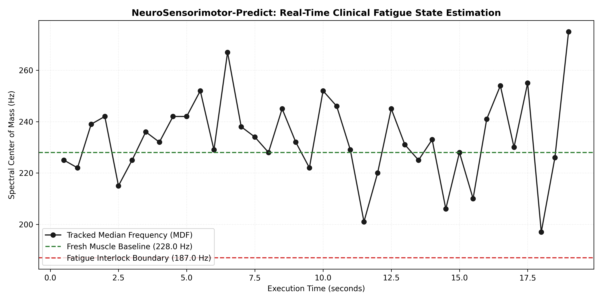

# NeuroSensorimotor-Predict: Predictive Neuromuscular Fatigue Decoding for Surgical Teleoperation

An open-source Python pipeline designed to decode real-time surface Electromyography (sEMG) streams, tracking spectral compression to predict human motor control degradation before fine-motor surgical errors occur.

## Physiological Paradigm
In delicate haptic and master-slave surgical teleoperation loops, operator hand tremors and errors are highly correlated with sensorimotor fatigue. As muscle fibers fatigue, their electrical firing frequencies compress downward *before* visible physical deviations manifest. This pipeline implements a sliding-window Short-Time Fourier Transform (STFT) framework to isolate the Median Frequency (MDF) vector, serving as a predictive safety trigger for active surgical interlocks.

## Core Features
- **Signal Condition Unit:** Implements 4th-order Butterworth bandpass filtering (20–450 Hz) and spectral notch filtering (50 Hz powerline attenuation) via `scipy.signal`.
- **Spectral Center Tracker:** Extracts instantaneous Power Spectral Density (PSD) using Welch’s method to calculate cumulative power trajectories.
- **Predictive State Estimator:** Monitors real-time spectral decay and executes a change-point interlock when tracking indices deviate more than 20% from nominal baselines.

## Visual Verification Output
The system tracks the progressive compression of the raw biosignal spectrum, flagging fatigue onset several seconds before fine-motor precision drops:

